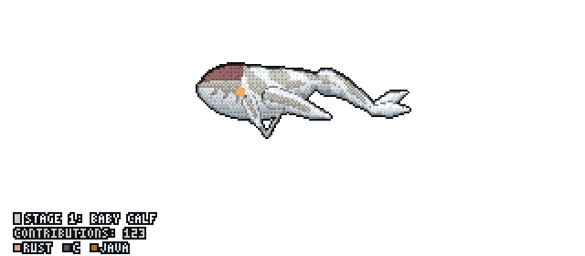

# Hi, I'm Shinya Tamaki! 👋

### Computer Science Student @ Cebu Institute of Technology – University 🇵🇭

---

### 🚀 Currently Working On & Learning
- 🦀 **Rust** — Systems programming and memory safety
- ♟️ **Chess Engine** — Bitboards, search algorithms, and evaluation logic

---

### 💻 Languages & Technologies

### 🛠️ Tools & Environment

---

### 📊 Git Metrics

  

